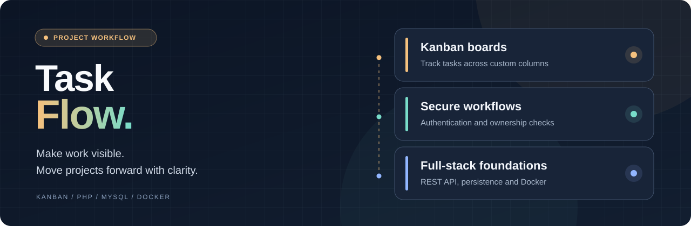

<p align="center"></p>

<h1 align="center">TaskFlow</h1>

<p align="center"><strong>A full-stack Kanban task manager built with PHP 8.2, MySQL and vanilla JavaScript — from authenticated workspaces to drag-and-drop task flows.</strong></p>

<p align="center"><a href="README.fr.md">Lire en français</a> · <a href="#overview">Overview</a> · <a href="#features">Features</a> · <a href="#architecture">Architecture</a> · <a href="#start">Get started</a> · <a href="#quality">Quality</a> · <a href="#faq">FAQ</a> · <a href="#license">License</a></p>

<p align="center"> </p>

<a id="overview"></a>
## Overview

TaskFlow is a self-hostable Kanban application for organizing work into boards, columns and tasks. It demonstrates the end-to-end construction of a small project management product, including browser interactions, REST endpoints, authentication, relational persistence and local container orchestration. It is a focused task workflow application, **not a claim to replace enterprise project management suites**.

**Intended audience :** Developers, small project teams and portfolio reviewers interested in the implementation of task and board workflows.

**Typical workflow:** Register or sign in, create a board, define columns, add tasks and move them between workflow stages with drag and drop. Changes are persisted through the PHP API.

<a id="features"></a>
## Features

| Capability | Description |
| --- | --- |
| **Boards and columns** | Create, rename, reorder and delete workflow structures. |
| **Task management** | Create, edit, move and delete tasks within a board. |
| **Authentication** | Registration, login and refresh-token handling. |
| **Ownership controls** | API-level checks restricting access to resources belonging to the user. |
| **Drag and drop** | Moves are persisted through dedicated API endpoints. |
| **Local deployment** | Nginx, PHP and MySQL services defined in Docker Compose. |

<a id="architecture"></a>
## Technical architecture

The application separates the public/ browser interface, src/ PHP code, database/ migrations and seed data, and docker/ container configuration. Its HTTP API exposes authentication, boards, columns and tasks. The frontend is written in vanilla JavaScript and CSS, without a JavaScript UI framework.

**Stack:** PHP 8.2, PDO, MySQL 8, Nginx, vanilla JavaScript, Docker Compose and PHPUnit. Authenticated API routes use JWT access tokens and refresh sessions; password hashing and request validation are described in the repository.

<a id="start"></a>
## Getting started

**Prerequisites:** Docker Compose and PHP/Composer for the documented local setup. Configure .env from .env.example before starting the containers. The example includes development-only defaults.

```bash
git clone https://github.com/hrmonic/task-flow.git
cd task-flow
cp .env.example .env
composer install
docker compose up -d --build
docker exec taskflow-php php database/migrate.php
docker exec taskflow-php php database/seed.php
```

Open http://localhost:8080 after the services have started. On Windows, copy the environment file manually if needed. A separate PHP built-in-server mode is documented in the source README history, but the complete setup relies on a MySQL instance.

<a id="quality"></a>
## Quality, security and limitations

Documented safeguards include Argon2id password hashing, prepared SQL statements, JWT handling, ownership checks, CSRF tokens, CORS configuration and response security headers. The repository currently includes focused PHPUnit unit tests but no detected GitHub Actions CI workflow.

### Known limitations and safeguards

- The example .env and Compose configuration use development credentials and must be hardened before public exposure.
- These security measures do not constitute a production security audit.
- No LICENSE file is currently included, so reuse rights are not expressly granted.
- The scope is Kanban task tracking, not full agile portfolio or sprint management.

### Potential improvements

- Add a license after choosing a distribution policy.
- Broaden API and business-rule tests and add CI.
- Publish genuine screenshots and a short end-to-end walkthrough.
- Consider project-level reporting only after validating its need.

### Further documentation

- [Project checklist](CHECKLIST.md)
- [Project specification](projet.md)

<a id="faq"></a>
## Frequently asked questions

### What can I manage in TaskFlow?

The application provides boards, configurable columns and movable tasks.

### Does TaskFlow require Docker?

The documented complete local stack uses Docker Compose; components can be configured manually by experienced developers.

### Where are tasks stored?

In MySQL, accessed through the PHP backend.

### Is this ready for public production hosting?

The repository documents several protections, but deployment requires hardening and an independent security review.

<a id="license"></a>
## License and maintainer

**No license file is currently published in this repository.** Public visibility does not automatically grant rights to copy, modify or redistribute the source code. A license should be chosen before encouraging third-party reuse.

**Maintainer:** [Réda Touzani (@hrmonic)](https://github.com/hrmonic).

---

*A focused full-stack Kanban case study: build the workflow, understand the data, verify the behavior.*
